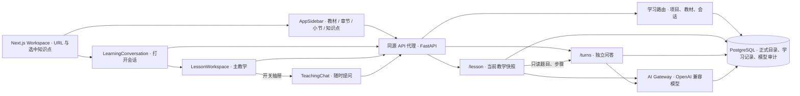

# Learning Protocol 1.0 · Phase 0 实施审计

审计日期：2026-11-14（太平洋时间）

源码基线：`4593dd1bd163ff6eae5a224dcede2cb268da1a52`；本机 PostgreSQL 18.6，迁移 `0011_learning_lessons`。通读用户提供的《Learning_Protocol_1.0_开发协议.md》§0–16 及附录 A/B；下文的章节和阶段均指这份协议。仓库的 `mainbook.md`、V2 规格、交接及运行手册用于查找现状；以源码、数据库和本轮实测为准。本轮仅盘点和验证，Phase 1 等用户审阅后开始。

**结论：已有可复用的双窗、服务端步号、进度保存和并发保护，但还不是按计划教学。** 当前步骤是模型即时生成的；后端递增步号，却依赖模型的 `final` 决定是否结束。提示和检测走真实后端，尚不具备三级提示、独立检测证据和失败后保留作答的能力。本轮全部 177 项后端、143 项前端及 10 项工具测试通过；其中的测试替身只证明连接与状态行为，不证明真实模型讲解质量或协议已达标。

## 1. 当前架构与数据流

技术栈：Next.js 16.4.5 / React 19.3.1 / TypeScript / CSS（浏览器随系统深浅色）；FastAPI / Pydantic / SQLAlchemy async / Alembic / PostgreSQL。Redis 承担限流，命题和问答是请求内的模型调用，Celery 与 S3 兼容存储不在这条教学路径上。开发运行及验收入口见 [RUNBOOK.md](RUNBOOK.md)。

1. **选中知识点。** [Workspace](frontend/components/workspace.tsx#L19)、[AppSidebar](frontend/components/app-sidebar.tsx#L145) 和 [LearningProjectNavigation](frontend/components/learning-project-navigation.tsx#L82) 读取正式目录，使用 `/?view=learning&section=…&point=…` 或旧 `?view=learning&project=…`。 [LearningConversation](frontend/components/learning-conversation.tsx#L20) 按 URL 打开或复用小节项目和知识点会话；空小节走现有知识点草稿与显式确认。打开项目会保存最后选择及访问时间，不产生题目。
2. **读取或改变主窗。** [LessonWorkspace](frontend/components/lesson-workspace.tsx#L39) 挂载时读取最新快照；点击按钮才提交操作。后端先查会话归属、已成功的 `request_id` 和当前 `revision`；模型请求前提交审计记录并释放事务，返回后获课程行锁，在提交事务里复核知识点内容版本、请求号和最新进度，再追加一条快照。模型失败不会写新教学快照；提交成功后才返回状态。浏览器的请求引用和禁用状态隔离重复点击，卸载会取消浏览器侧请求。
3. **单独问答。** [TeachingChat](frontend/components/teaching-chat.tsx#L29) 首次打开加载历史，关闭时仅隐藏，保留草稿与已加载消息；刷新后重新读取持久历史。服务端通过 [teaching.py](backend/app/learning/teaching.py#L119) 取当前主窗题目／步骤快照和最近最多 12 轮，问答以自己的请求号、序号和事务追加，入口只写问答表。无回流到主窗的困惑摘要，也没有按题隔开的问答历史。

## 2. 实际接口和按钮

下列路径均以 `/api/v1` 开头，已用运行中的 FastAPI OpenAPI 对照源码。浏览器经 [learning.ts](frontend/lib/learning.ts) 和 [business-proxy.server.ts](frontend/lib/business-proxy.server.ts#L3) 调用。学习接口要求登录并校验资源归属；同源代理对写操作校验来源。响应外层为 `success / data / error`，错误为 `code / message / details`。

| 方法与路径 | 当前用途 |
| --- | --- |
| `GET /learning/projects?before=…` | 最近访问的小节项目；游标分页，每页 6 项。现行左栏以教材列表为入口。 |
| `POST /learning/projects` | 按 `section_id` 和可选 `knowledge_point_id` 创建或打开小节项目，返回会话和正式知识点。 |
| `POST /learning/projects/{project_id}/open` | 打开旧项目链接；恢复选中知识点（支持可选 `knowledge_point_id`）。 |
| `GET /learning/projects/textbooks?before=…` | 当前左栏教材列表，按添加顺序游标分页。 |
| `GET /learning/projects/textbooks/{course_id}` | 读该教材的正式章节、小节、知识点及 `studied`；标记来自知识点自身状态。 |
| `PUT /learning/projects/textbooks/{course_id}`、`DELETE` 同路径 | 添加或从侧栏移除教材显示；不删除课程和会话。 |
| `GET /learning/conversations/{conversation_id}/lesson` | 最新主窗快照：未开始为 `{revision:0}`，否则含 `revision, problem, step, complete, support, check`。不返回计划、题目 ID 或总步数。 |
| `POST /learning/conversations/{conversation_id}/lesson` | `{request_id, revision, action, response?}`；同一路径分发六种操作，已成功的同请求重试返回原快照。 |
| `GET /learning/conversations/{conversation_id}/turns?before=…` | 独立问答，按序号向前分页，每页最多 30 轮。 |
| `POST /learning/conversations/{conversation_id}/turns` | `{request_id, after, question}`；生成并保存问答，返回 `id, position, question, answer`。 |

相邻依赖：[课程](backend/app/courses.py#L61)供「我的课程」读取及选择课程；空小节的 [知识点接口](backend/app/knowledge/routes.py#L66) 为 `GET/PATCH /sections/{section_id}/knowledge-points` 和其 `POST /drafts`、`/confirm`、`/generate`；其中生成草稿用 [extract-v3.md](backend/prompts/knowledge/extract-v3.md)，不是教学规划。主窗和辅窗选用账户既有启用模型（[context.py](backend/app/learning/context.py#L37)），服务端直接调用网关，不转调用户可见的 `POST /ai/calls`。

| UI 操作 | 实际命令与状态来源 |
| --- | --- |
| 开始学习 / 下一题 | 都用 `start`，分别在无快照／已完成时允许；一次模型调用返回题目与第一步，后端设步号 1。下一题会把旧题传作上下文，由 Prompt 要求换题，服务端未校验是否重复。 |
| 我理解了，下一步 | `next`，保留原题，模型即席生成讲解，后端步号加一；清除旧步骤的当前提示与检测展示。 |
| 我理解了，完成本题 | 同为 `next`。UI 根据快照的 `step.final` 换文案，后端据同一值设 `complete=true`，不调用模型、不自动开始下一题。旧快照的 `final` 来自模型。 |
| 换一种方式 / 给我提示 | `explain` / `hint`，回写同一个 `support` 槽位，新快照不会改变步号。无提示级别或次数控制。 |
| 验证一下 / 提交回答 | `check` 生成短题写入 `check`，`evaluate` 把检测题及作答传给模型、把反馈写入 `support`；成功时作答随该修订写入 `response`。检测无独立 ID，作答成功后输入清空但题目仍可提交；评价失败只在当前页面保留未提交的输入。 |
| 随时提问 / 发送 | 面板开关是本地状态；发送才调用 `/turns`。问答和主教学各自加载、报错、恢复，主窗进度不因问答变化。 |

## 3. 数据与模型验证

| 持久层 | 实际数据与约束 |
| --- | --- |
| `courses → chapters → sections → knowledge_points`，`structure_versions` | 正式课程、教材目录和知识点内容；知识点有定义、学习目标、掌握标准、状态及内容版本。教学路由只读这些内容，未把学生点击或检测反馈写成掌握度。 |
| `learning_textbooks` / `learning_projects` / `learning_conversations` | 教材显示偏好按课程；项目唯一键为用户 + 小节；会话唯一键为项目 + 知识点。会话保存首次打开时的 `content_version_id`，教学模型目前读取该点的**现行**内容，保存前仅复查单次调用期间有无变化。 |
| `learning_lesson_revisions` | 主窗追加快照：`conversation_id, revision, request_id, action, response, state(JSON)` 及时间戳；按会话约束修订号、请求号唯一。当前态取最大修订；历史修订保留，但无对外步骤历史查询、无按题主键或冻结计划。 |
| `learning_turns` | 辅窗独立：`conversation_id, position, request_id, question, answer` 及时间戳；按会话约束序号和请求号唯一。没有 `question_id` 或发问时的主窗版本字段。 |
| `ai_call_logs` | 已记录供应商、模型名、任务类型、Prompt/网关版本、状态、耗时、重试次数、用量及错误码；不存密钥或内容，当前未把审计记录与特定教学修订、计划或步骤关联。 |

依据：[ORM](backend/app/learning/models.py)、[最新快照查询](backend/app/learning/lesson_state.py#L12)、迁移 [0008](backend/migrations/versions/0008_learning_projects.py)、[0009](backend/migrations/versions/0009_learning_textbooks.py)、[0010](backend/migrations/versions/0010_learning_turns.py)、[0011](backend/migrations/versions/0011_learning_lessons.py)。本机采用只读事务核对了表列、外键、唯一键和聚合数：1 个项目、6 个对话、1 条教材显示记录、1 轮独立问答、1 个会话内 3 条主窗旧修订（`start/check/evaluate`，无已完成快照）。未导出用户内容；这些计数只代表本机审计时点。

- **主窗 Prompt**：[lesson-v2.md](backend/prompts/learning/lesson-v2.md) 是当前加载的版本，[lesson-v1.md](backend/prompts/learning/lesson-v1.md) 是旧模板。v2 用一个 Prompt 分发六种行为，把经裁剪的课程材料、现题、当前步骤与按需传入的检测题/回答传给模型。没有规划器、目标化步骤输入、先修关系或已学摘要；模板明确要求模型填写 `final`。开始返回 `{problem,title,content,final}`，推进返回 `{title,content,final}`，其他返回 `{text}`。主窗字段一律必填，禁止额外字段，非空文本上限 3000 字符，标题上限 120。
- **辅窗 Prompt**：[teaching-v1.md](backend/prompts/learning/teaching-v1.md) 要求围绕当前问题、参考主窗且不代替推进或透露后续完整解法。它收到裁剪后的题面/当前讲解与受预算限制的近期对话；缺步骤目标、已完成摘要和困惑记录，不区分同一知识点下的不同题目。当前用普通 `chat` 文本路径，只检查去空白后非空，**没有**协议要求的 `{text}` JSON 校验。模型在辅窗无教学写入能力，但内容不越界仅由 Prompt 约束。
- **校验与事务**：[Gateway](backend/app/ai/gateway.py#L17) 负责 JSON 解析和 Draft 2020-12 Schema 校验，不合格追加 [repair.md](backend/prompts/gateway/repair.md) 提示；默认最多重试两次，教学调用设 120 秒上限。校验只覆盖结构；未检验是否偏离步骤、重复讲解或提前泄露答案。 [prepare](backend/app/ai/service.py#L121) 提供脱敏审计与现有适配器。保留现行 OpenAI 兼容接入，教学语义校验放学习模块。

## 4. 协议差距与 UI 审计

| 优先级 / 协议 | 现有基础和待补缺口 |
| --- | --- |
| **阻断 · §2–4、§6–7、§12** | 服务端维护步号与题面；缺 `LessonPlan`、独立题目身份、计划版本、难度、总步数、每步目标/概念/完成标准/禁止项、先修与内部参考答案。最后一步由模型选择。应先从平台生成或绑定身份，再凭冻结计划推进；对学生只返回当前任务所需摘要。 |
| **阻断 · §5.2–5.3、§7、§11** | 已有 `request_id + revision`、唯一约束与提交时课程锁，实测不会并发写两步。但相同或不同请求可能在锁前各自调用模型；重放可能返回旧快照；浏览器在 409 时引导重载，网络超时未主动读取权威状态。缺明确完成/下一题命令、预期题目/计划/步骤前置条件、步骤内容 ID、持久确认时间，以及能区分规划、讲解、等待检测和完成的服务端状态。 |
| **高 · §5.4–5.7、§7.5、§12** | 真辅助操作不推进；缺三级提示记录、独立检测 ID/题/答/评价及时间、评价失败后可恢复答案、教师纠错分类与困惑摘要。实际辅窗跨题共享历史；应保留历史并只注入当前任务所需上下文。 |
| **高 · §8–10、§13.6** | 可复用左侧选中态、长标题换行、侧栏折叠、主辅两个滚动区、单独问答输入和焦点恢复。当前主窗顶部只有知识点和提问入口；题目和步骤用同样的标题/正文层级，缺课程上下文、当前目标与进度、可读的公式/代码/表格渲染、历史折叠和完成摘要。当前按钮有一主三次，但共用一行操作区与笼统的“导师正在准备…”，错误集中在主窗底部，辅窗缺当前题/步提示和无历史引导。 |
| **高 · §13、§14** | 已有 FastAPI TestClient / pytest（学习集成测试用临时 SQLite 和网关替身）、Ruff、Vitest/jsdom、TypeScript 和生产构建；前端测试覆盖侧栏、课程和代理，未找到主窗、辅窗组件专项自动化。仓库名为 Phase 0 的旧整栈验收脚本仍固定断言 `0008_learning_projects` 和旧表名单（[scripts/phase0.mjs](scripts/phase0.mjs#L74)，重启后也断言 `0008`），与实际迁移头不符；当前工作流调用该脚本。这是独立的验收基线缺口。 |

**界面证据。** 工作台属操作型详情页。以现有 [DESIGN.md](DESIGN.md)、[tokens.css](frontend/styles/tokens.css#L44) 和 [learning.css](frontend/styles/learning.css#L22) 为基础保留深浅色、共享按钮与连续曲率圆角。正文容器上限已是 800 px，段落行高 1.75；现有文本走 React 转义。深色浏览器实看 1280×720、1024×768、390×844：所测状态未发生页面级横向溢出；1280px 时开辅窗后主窗宽 681 px、辅窗宽 351 px；390px 时辅窗占据主区，关闭恢复主窗滚动与焦点，重开保留草稿，刷新恢复已保存问答及检测反馈。题面和步骤确实会因提示请求滚到视口之外；辅窗代码在发送和收到回复时都安排滚到底部，未按用户是否在底部判定（长历史此项未独立实测）。题目内 Markdown 标记和公式定界符按原字串显示。代码已提供按钮/文本框名称、区域和部分状态通知；新问答没有独立简短播报。本轮未做浅色、新消息长历史、实机软键盘、完整对比度、屏幕阅读器或不同浏览器验收。

**Phase 4 建议。** 以「我在学什么 → 当前题目 → 本步目标与讲解 → 可做的下一件事」排版。将题面与当前步骤分成不同阅读区域，长内容用不遮挡正文的题目摘要；检查与反馈放回当前步骤，辅助按钮成组，推进/完成始终是唯一主操作。桌面右侧问答保持主区可读，窄屏覆层保留来回焦点、主窗滚动和输入；分别定义等待、空、失败、冲突、完成等状态。复用主题与现有组件，验收阅读顺序、键盘和长公式边界，而不以颜色或圆角变动代替结构调整。

## 5. 迁移风险和职责边界

| 风险 | 建议及验证 |
| --- | --- |
| 旧修订没有完整计划，部分旧题还在进行 | 追加新结构，从 `conversation_id` 挂接教学任务。保留原表与快照；旧记录按原文可打开，明确告知可用操作。建议将无计划旧记录作为兼容历史、从明确的新题操作创建协议任务，由产品确认旧中途题如何继续。不可用模型倒推旧计划、补写完成时间或把旧 `final` 当新协议事实。 |
| 多题及多次检测共用快照字段，旧问答无题目关联 | 新题、步骤、检测、作答和评价应有明确归属；旧问答保留会话级历史，未记录题目者不自动归因。兼容校验保留旧步号清理但不改原文，验证合法数字、公式和跨题隔离。 |
| 新旧结构混用与课程版本变化 | 保住课程、教材、章节、小节、知识点及现行 URL/权限；冻结计划同时绑定其读取的知识点版本，识别跨操作版本变化并明示恢复策略。新读写契约在已有代理内协调，兼容字段若保留必须由新状态派生。用隔离 PostgreSQL 覆盖空库、含旧数据升级、应用回滚与原始数据校验；有数据的旧表降级本就受保护，禁止用重置测试替代迁移。 |
| 长模型调用、并发重试和共享限流 | 保留目前短事务提交与课程所有权复核，新任务的预期题目/计划/步号与幂等结果应由持久层判断。规划和第一步作为业务上的完整开始；模型或提交失败保留上一次成功状态，检测先保存答案再尝试评价。分阶段核对网关和代理时限（当前分别 120/185 秒）、重复模型调用与学生完整操作的限流预算；现有主辅模型动作共用每账户 10 次/600 秒的 AI 限额，本轮连续操作已触发 429 并保留原进度。 |

**解耦基线：有保留项。** 目录树与正式课程数据、模型网关和独立问答持久化可复用。主窗路由当前同时分发命令、内嵌 Schema/Prompt 构建、转换状态和入库；辅窗直接读取主窗 JSON。后续让学习服务拥有状态和写事务、模型服务只根据明确上下文返回候选结果、UI 只读公开任务快照并提交命令、辅窗只消费明确的只读上下文。保持单向依赖；复用网关替换点与现有测试适配。不把本题完成、检测结果和知识点掌握状态混用。实现后再独立验收状态归属、请求取消、事务失败及旧数据兼容；本轮未作实现复查。

附录 B 待后续产品确认：旧记录是否迁移或仅作兼容历史；默认允许跳过检测继续；三级以后是否停止或重复强提示；是否提供重新规划入口；是否将掌握度接入复习；是否需要将供应商/模型/Prompt 审计与具体教学产物关联以便复现。本轮不定这些产品行为，也不调整课程、教材定义或学习目标。

## 6. 建议施工顺序

| 阶段 | 在现有实现上增量推进及对应验收 |
| --- | --- |
| Phase 1 · 协议与模型 | 定义计划、步骤、操作结果及公开快照，明确冻结、旧记录读取、加法迁移和回滚；补 Schema 单测与含旧记录的 PostgreSQL 迁移检查。同步校准旧整栈脚本的迁移基线。 |
| Phase 2 · 后端状态机 | 沿用会话、权限、请求号和课程锁路径，以持久任务、题/计划/步前置条件和事务控制推进；分离主动完成与下一题，保证失败不写新进度。测并发、重放、超时后读取、过期请求和写入失败。 |
| Phase 3 · AI 教学服务 | 在现有网关之上拆规划器、步骤讲解、辅助操作/评价及辅窗模板；做计划一致性验收、有限修复、三级提示和检测生命周期。保留脱敏日志，补异常、重复和提前泄露用例。 |
| Phase 4 · 前端 | 落实上下文、题目与步骤层级、操作与错误、渲染和双窗布局；根据服务端快照显示进度和可执行动作。补组件测试及目标视口、主题、键盘和长内容实测。 |
| Phase 5 / 6 · 联调与发布检查 | 按协议 §13 和 §14 跑完整流程与故障回归；在授权环境验证真实模型教学质量、多主题设备、旧记录恢复及备份回滚。发布前只汇报实际通过与未测项。 |

## 7. Phase 0 本轮验证

| 检查 | 结果 |
| --- | --- |
| 后端：项目 Dockerfile 的 test 阶段，隔离运行 `ruff check .`、`ruff format --check .`、`pytest -q` | 通过：177 项，87 个文件格式一致；1 条 Starlette TestClient 弃用警告。学习用例见 [主窗](backend/tests/test_learning_lessons.py#L13) 与 [辅窗](backend/tests/test_learning_teaching.py#L9)。 |
| 前端：项目 Dockerfile 的 test 阶段，隔离运行 `npm run check`、`npm test`、`npm run build` | 通过：TypeScript、11 个测试文件共 143 项、Next.js 优化生产构建。四个相关前端源文件的 impeccable 规则扫描无命中；这是静态检查。 |
| 工具：`node --test scripts/infra.test.mjs scripts/production.test.mjs` | 通过：10 项。 |
| 当前本机基线（只读） | 首页、同源 health/ready 200；未认证的主窗、辅窗及教材入口 401；OpenAPI 路由与源码相符。 PostgreSQL 确认迁移头为 `0011_learning_lessons`。 |
| 独立 PostgreSQL + 实际 HTTP/代理 + 本地 OpenAI 协议替身 | 空库迁移并重复升级成功。同题同修订的并发下一步为 200/409；重放成功请求未再次推进；问答不改主快照；完成、完成后再次 `start` 回到第 1 步及 GET 恢复通过。替身固定题面，不验证新题与旧题是否不同；`final` 仍由模型输出。 |
| 浏览器（隔离账户/课程 + 同一模型替身） | 三种视口实测如 §4。确认提示、换讲法、检测提交和辅窗确实走后端；刷新恢复第一步、检测反馈及对话。连续操作触发既有 AI 限流时，浏览器展示错误且第一步仍在；完成状态与下一题入口对应的后端操作由上面的同源 HTTP 验证。 |
| 未执行/未覆盖 | 未运行旧 `scripts/phase0.mjs verify` 全流程或远端 CI；其迁移断言失配已由源码与独立数据库核实。未作真实模型、真实用户数据写入、旧库升级演习或全套 Phase 5/6 验收。 |

本次验证使用独立容器、卷、临时课程和模型替身；这些只供测试，不属于产品功能或真实教学结果。审计后移除本次独占测试环境及原始临时证据，保留此报告。
